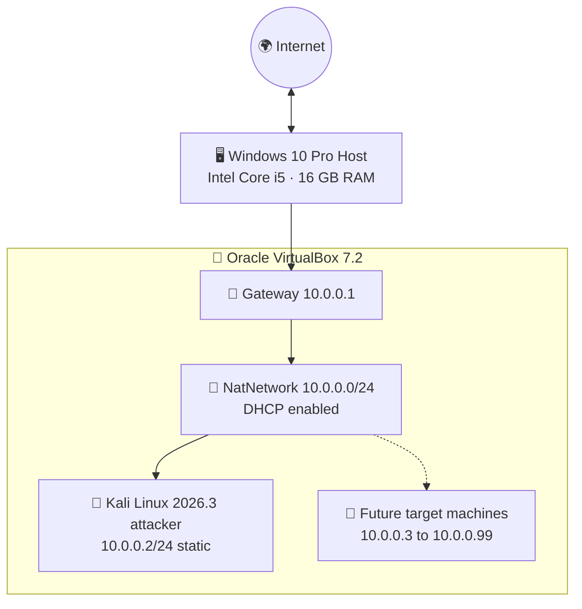

<div align="center">

# 🔐 Cybersecurity Lab Environment Setup

### VirtualBox + Kali Linux on an Isolated NAT Network (10.0.0.0/24)

**NetworkWalks Cybersecurity Internship · Week 1 · Project Module 1 (WK1-PM1)**

Built and documented by **Musadiq Mehmood Qureshi**

[](https://www.linkedin.com/in/musadiq-qureshi-32271936a)

</div>

<p align="center">
  <a href="https://www.networkwalks.com"></a>
  <a href="https://www.kali.org"></a>
  <a href="https://www.virtualbox.org"></a>
  
  
  
  
  <a href="https://www.networkwalks.com"></a>
  
  
</p>

---

## 📑 Table of Contents

1. [Project Overview](#-project-overview)
2. [Objectives](#-objectives)
3. [Task Requirements Checklist](#-task-requirements-checklist)
4. [Lab Architecture](#-lab-architecture)
5. [Lab Configuration](#-lab-configuration)
6. [Lab Setup Procedure](#-lab-setup-procedure)
7. [Troubleshooting](#-troubleshooting)
8. [Phase 2 – Future Lab Machines](#-phase-2--future-lab-machines)
9. [Repository Structure](#-repository-structure)
10. [Legal & Ethical Use](#-legal--ethical-use)
11. [Author](#-author)
12. [Acknowledgements](#-acknowledgements)

---

## 📌 Project Overview

This project documents the setup of a **virtual cybersecurity and penetration-testing laboratory** using **Oracle VirtualBox** and **Kali Linux**.

The lab is a controlled environment where security tools, network scanning, reconnaissance, vulnerability assessment and other security-testing activities can be practised safely and repeatedly. It runs on a **private virtual network (NAT Network)**, so additional machines can be added later and used as targets for **authorized** security testing.

| Item | Details |
|---|---|
| 🎓 Internship | NetworkWalks Cybersecurity Internship |
| 📦 Module | Week 1 – Project Module 1 (WK1-PM1) |
| 👨‍🏫 Instructor | Waqas Karim (CCIE) |
| 🧰 Hypervisor | Oracle VirtualBox 7.2 |
| 🐉 Operating System | Kali Linux 2026.3 |
| 🌐 Network | NAT Network – `10.0.0.0/24` |

---

## 🎯 Objectives

- Install and configure VirtualBox (latest recommended version).
- Install / import Kali Linux as a virtual machine (the attacking machine).
- Create a private **NAT Network** (`NatNetwork`, `10.0.0.0/24`) for the lab.
- Enable shared clipboard, drag & drop and a shared folder between host and VM.
- Assign a fixed IP address (`10.0.0.2/24`) to the Kali VM.
- Verify network connectivity, internet access and DNS resolution.
- Take a clean VM snapshot for fast recovery.
- Document the complete process and prepare the environment for future projects.

---

## ✅ Task Requirements Checklist

Requirements taken from the project task brief (`WK1-PM1`):

| # | Requirement | Status | Where |
|---|-------------|:------:|-------|
| 1 | Use VirtualBox as base (latest recommended version) | ✅ | [Step 2](#step-2--download--install-virtualbox) |
| 2 | Set up Kali Linux as the attacking / hacker machine | ✅ | [Step 4](#step-4--download--import-kali-linux) |
| 3 | Set up the network in subnet `10.0.0.0/24` | ✅ | [Step 3](#step-3--create-the-nat-network) |
| 4 | Use a NAT Network with `10.0.0.0/24` | ✅ | [Step 3](#step-3--create-the-nat-network) |
| 5 | Clipboard & file drag/drop enabled in VM settings | ✅ | [Step 4](#step-4--download--import-kali-linux) |
| 6 | Shared folder enabled with the host `Downloads` folder | ✅ | [Step 4](#step-4--download--import-kali-linux) |
| 7 | Kali Linux IP address is `10.0.0.2/24` | ✅ | [Step 5](#step-5--configure-the-ip-address-of-kali-linux) |
| 8 | Kali Linux has full internet access | ✅ | [Step 5](#step-5--configure-the-ip-address-of-kali-linux) |
| 9 | Snapshot of the VM taken | ✅ | [Step 6](#step-6--take-a-snapshot-of-the-vm) |

---

## 🧱 Lab Architecture



A **NAT Network** was chosen because all VMs attached to the same NAT Network can talk to each other *and* still reach the internet through the host. This lets future attacker and target VMs communicate inside the lab while staying isolated from the physical LAN.

---

## 🔧 Lab Configuration

| 🧩 Component | ⚙️ Configuration |
|---|---|
| 🖥️ Host OS | Windows 10 Pro |
| 🧠 Host RAM | 16 GB |
| ⚡ Host Processor | Intel Core i5 |
| 🧰 Hypervisor | Oracle VirtualBox 7.2 (+ Extension Pack) |
| 🐉 Security OS | Kali Linux 2026.3 (Rolling) – official VirtualBox 64-bit image |
| 🧮 Kali vCPUs | 2 |
| 🧠 Kali RAM | 2048 MB |
| 💾 Kali Disk | 80.09 GB (VDI, dynamically allocated) |
| 🖼️ Kali Video | VMSVGA, 128 MB |
| ⚡ Acceleration | Nested Paging, PAE/NX, KVM paravirtualization |
| 🌐 Virtual Network | NAT Network – `NatNetwork` |
| 📡 Network Address | `10.0.0.0/24` (DHCP enabled, IPv6 disabled) |
| 🔌 Adapter | Adapter 1 · Intel PRO/1000 MT Desktop (82540EM) · Promiscuous Mode: Allow All |
| 🐧 Kali IP Address | `10.0.0.2/24` (static) |
| 🚪 Default Gateway | `10.0.0.1` |
| 🌍 DNS Server | `8.8.8.8` |
| 🔮 Future VM Range | `10.0.0.3 – 10.0.0.99` |
| 📋 Shared Clipboard | Bidirectional |
| 🖱️ Drag and Drop | Bidirectional |
| 📂 Shared Folder | Host `Downloads` folder (auto-mount, permanent) |

<!-- ================================================================ -->
<!-- 📸 IMAGE 1 of 5 — PASTE YOUR IMAGE LINK HERE (inside src="...")   -->
<!-- Current path: images/02-vm-specifications.png                     -->
<!-- ================================================================ -->
<p align="center">
  <br>
  <sub><b>Figure 1.</b> VirtualBox Manager – Kali Linux VM specifications (system, storage and network).</sub>
</p>

---

## 🪜 Lab Setup Procedure

### Prerequisites

Before downloading any of the required files, I **disabled the Windows hypervisor** (Hyper-V / virtualization-based features) so VirtualBox can use hardware virtualization directly, and I **enabled virtualization** (Intel VT-x) on my machine.

> 💡 Check in Task Manager → Performance → CPU that *Virtualization: Enabled* is shown.

---

### Step 1 – Download & install 7-Zip

The Kali Linux VirtualBox image is distributed as a `.7z` archive, so a 7-Zip-compatible archiver is needed to extract it.

🔗 https://7-zip.org/download.html

---

### Step 2 – Download & install VirtualBox

I downloaded **Oracle VirtualBox** and the matching **Extension Pack** from the official website and installed VirtualBox as the hypervisor.

🔗 https://www.virtualbox.org/wiki/Downloads

---

### Step 3 – Create the NAT Network

A dedicated NAT Network was created in VirtualBox:

**File → Tools → Network → NAT Networks → Create**

| Setting | Value |
|---|---|
| Name | `NatNetwork` |
| IPv4 Prefix | `10.0.0.0/24` |
| Enable DHCP | ✔ Enabled |
| Enable IPv6 | ✘ Disabled |

<!-- ================================================================ -->
<!-- 📸 IMAGE 2 of 5 — PASTE YOUR IMAGE LINK HERE (inside src="...")   -->
<!-- Current path: images/03-nat-network.png                           -->
<!-- ================================================================ -->
<p align="center">
  <br>
  <sub><b>Figure 2.</b> NatNetwork created with prefix 10.0.0.0/24 and DHCP enabled.</sub>
</p>

---

### Step 4 – Download & import Kali Linux

The pre-built Kali Linux VirtualBox image was downloaded from the official Kali website, extracted with 7-Zip and added to VirtualBox (**Machine → Add…** → select the `.vbox` file).

🔗 https://www.kali.org/get-kali

> 🔑 Default credentials of the official pre-built image: `kali` / `kali`. Change the password after the first login.

**4.1 – Network adapter**

| Setting | Value |
|---|---|
| Adapter 1 | Enabled |
| Attached to | `NAT Network` |
| Name | `NatNetwork` |
| Adapter Type | Intel PRO/1000 MT Desktop (82540EM) |
| Promiscuous Mode | Allow All |
| Virtual Cable Connected | ✔ |

<!-- ================================================================ -->
<!-- 📸 IMAGE 3 of 5 — PASTE YOUR IMAGE LINK HERE (inside src="...")   -->
<!-- Current path: images/04-vm-network-adapter.png                    -->
<!-- ================================================================ -->
<p align="center">
  <br>
  <sub><b>Figure 3.</b> Kali VM → Settings → Network: Adapter 1 attached to <code>NatNetwork</code>.</sub>
</p>

**4.2 – Shared clipboard & drag and drop**

*Kali VM → Settings → General → Advanced*

- Shared Clipboard: **Bidirectional**
- Drag'n'Drop: **Bidirectional**

**4.3 – Shared folder (host `Downloads` folder)**

*Kali VM → Settings → Shared Folders → Add*

| Setting | Value |
|---|---|
| Folder Path | Host `Downloads` folder (`C:\Users\<username>\Downloads`) |
| Folder Name | `Downloads` |
| Read-only | ✘ (full access) |
| Auto-mount | ✔ |
| Make Permanent | ✔ |

Inside Kali the folder is mounted under `/media/sf_Downloads`. To get access, add the user to the `vboxsf` group and log out / in once:

```bash
sudo usermod -aG vboxsf $USER
ls /media/sf_Downloads
```

---

### Step 5 – Configure the IP address of Kali Linux

Kali was given a **static IP address** inside the NAT Network.

**Option A – GUI (NetworkManager)**

*Network icon (top-right) → Edit Connections → Wired connection 1 → IPv4 Settings*

| Setting | Value |
|---|---|
| Method | `Manual` |
| Address | `10.0.0.2` |
| Netmask | `24` |
| Gateway | `10.0.0.1` |
| DNS servers | `8.8.8.8` (use `10.0.0.1` if internet gives issues) |

**Option B – Command line**

```bash
sudo nmcli connection modify "Wired connection 1" \
  ipv4.method manual \
  ipv4.addresses 10.0.0.2/24 \
  ipv4.gateway 10.0.0.1 \
  ipv4.dns 8.8.8.8

sudo nmcli connection down "Wired connection 1"
sudo nmcli connection up "Wired connection 1"
```

**Verify the configuration**

```bash
ip a                      # eth0 should show 10.0.0.2/24
ip route                  # default route via 10.0.0.1
ping -c 4 10.0.0.1        # gateway reachable
ping -c 4 8.8.8.8         # internet reachable (IP level)
ping -c 4 google.com      # DNS resolution works
```

<!-- ================================================================ -->
<!-- 📸 IMAGE 4 of 5 — PASTE YOUR IMAGE LINK HERE (inside src="...")   -->
<!-- Current path: images/01-kali-desktop.jpg                          -->
<!-- ================================================================ -->
<p align="center">
  <br>
  <sub><b>Figure 4.</b> Kali Linux 2026.3 desktop running inside VirtualBox.</sub>
</p>

---

### Step 6 – Take a snapshot of the VM

With the lab configured and working, the VM was powered off and a clean snapshot named **`My Fresh Kali Linux`** was taken:

*VirtualBox Manager → Kali VM → Snapshots → Take*

If a later experiment breaks the system, the VM can be restored to this clean state in seconds.

<!-- ================================================================ -->
<!-- 📸 IMAGE 5 of 5 — PASTE YOUR IMAGE LINK HERE (inside src="...")   -->
<!-- Current path: images/05-vm-snapshot.png                           -->
<!-- ================================================================ -->
<p align="center">
  <br>
  <sub><b>Figure 5.</b> Snapshot <code>My Fresh Kali Linux</code> created for recovery.</sub>
</p>

---

## 🩹 Troubleshooting

**Kali VM has no internet?** (common with VirtualBox 7 and Kali 2026.1 or newer)

1. Check that the NAT Network `NatNetwork` was created properly (`10.0.0.0/24`).
2. Check that all network settings on the VM are correct (adapter, name, IP, gateway, DNS).
3. Make sure **no other VM** on the same NAT Network uses `10.0.0.2`.
4. Run the three commands below and restart Kali:

   ```bash
   sudo nmcli connection modify "Wired connection 1" ipv4.dad-timeout 0
   sudo nmcli connection down "Wired connection 1"
   sudo nmcli connection up "Wired connection 1"
   ```

5. Try `10.0.0.1` as the DNS server instead of `8.8.8.8`.
6. Restart the virtual machines and the host OS.

---

## 🔮 Phase 2 – Future Lab Machines

The same NAT Network is ready for additional, optional target machines. The virtual machines below are **planned future lab machines**; they are not installed yet.

| Virtual Machine | Planned IP |
|---|---|
| 🐉 Kali Linux (attacker) | `10.0.0.2/24` |
| 🪟 Windows 11 | `10.0.0.11/24` |
| 🪟 Windows 10 | `10.0.0.10/24` |
| 🤖 Android 9.x | `10.0.0.9/24` |
| 🪟 Windows 7 | `10.0.0.7/24` |
| 🖥️ Windows Server 2016 | `10.0.0.16/24` |

Next steps: install the target VMs, ping-test all machines from each other and take a snapshot of each.

---

## 📁 Repository Structure

```text
cybersecurity-lab-setup/
│
├── README.md
│
└── images/
    ├── 01-kali-desktop.jpg
    ├── 02-vm-specifications.png
    ├── 03-nat-network.png
    ├── 04-vm-network-adapter.png
    └── 05-vm-snapshot.png
```

---

## 🚨 Legal & Ethical Use

> ⚠️ **Important:** This cybersecurity laboratory must only be used on systems that **I own or where I have explicit written permission** to perform security testing. Never use the lab or its tools against unauthorized systems, networks or people. Unauthorized access to computer systems is illegal.

The lab is intended for **authorized** learning activities such as network reconnaissance, port scanning, vulnerability assessment, packet analysis, web security testing and security-tool experimentation.

---

## 👤 Author

**Musadiq Mehmood Qureshi**
NetworkWalks Cybersecurity Internship – Week 1, Project Module 1 (WK1-PM1)

[](https://www.linkedin.com/in/musadiq-qureshi-32271936a)

🔗 **LinkedIn:** [www.linkedin.com/in/musadiq-qureshi-32271936a](https://www.linkedin.com/in/musadiq-qureshi-32271936a)

---

## 🙏 Acknowledgements

- **NetworkWalks Academy** – course material and project task brief ([networkwalks.com](https://www.networkwalks.com))
- **Waqas Karim (CCIE)** – instructor
- **Oracle VirtualBox** ([virtualbox.org](https://www.virtualbox.org)) and **Kali Linux** ([kali.org](https://www.kali.org)) – the tools behind this lab

---

<div align="center">

⭐ If you found this documentation useful, feel free to star the repository.

</div>
